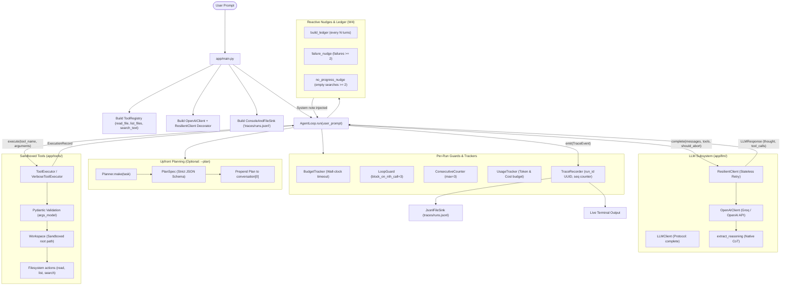

# Agent Runtime — Architecture & Workflow

ဤစာတမ်းသည် **Agent Runtime** ၏ High-Level System Architecture, Dependency Layering Rules, Runtime Guard Pipeline, Observability Workflow နှင့် Automated Evaluation Subsystem တို့ကို စနစ်တကျ ရေးသားထားသော စနစ်ဒီဇိုင်းလမ်းညွှန် ဖြစ်ပါသည်။

---

## မာတိကာ (Table of Contents)

1. [High-Level Architecture & Core Principles](#1-high-level-architecture--core-principles)
2. [Architectural Layering & Dependency Rules](#2-architectural-layering--dependency-rules)
3. [System Flowchart & Component Interaction](#3-system-flowchart--component-interaction)
4. [Runtime Guard Order & Safety Pipeline](#4-runtime-guard-order--safety-pipeline)
5. [Cognitive Architecture: Planning, Reasoning & Nudges (W4)](#5-cognitive-architecture-planning-reasoning--nudges-w4)
6. [Observability & Tracing Workflow](#6-observability--tracing-workflow)
7. [Resiliency, Retry & Fail-Fast Mechanics](#7-resiliency-retry--fail-fast-mechanics)
8. [Automated Evaluation Subsystem & Empirical Benchmark (W3 – W4)](#8-automated-evaluation-subsystem--empirical-benchmark-w3--w4)
9. [Core Design Principles & Takeaways](#9-core-design-principles--takeaways)

---

## 1. High-Level Architecture & Core Principles

Agent Runtime သည် **LangChain, LangGraph, CrewAI, LlamaIndex** ကဲ့သို့သော ပြင်ပ framework များကို လုံးဝမသုံးဘဲ Python 3.12 native standard libraries နှင့် Official Provider SDKs များကိုသာ အသုံးပြုကာ သန့်ရှင်းကျစ်လျစ်စွာ တည်ဆောက်ထားသော autonomous coding agent runtime ဖြစ်ပါသည်။

### အဓိက အခြေခံမူများ:
1. **Zero External Orchestration Frameworks**: Framework များ၏ opaque abstractions များနှင့် leaky state ကြောင့် debugging ခက်ခဲမှုကို ရှောင်ရှားပြီး Python core ဖြင့်သာ deterministic behavior ကို အာမခံသည်။
2. **Provider-Neutral Design**: Core agent loop သည် မည်သည့် LLM vendor (OpenAI, Anthropic, Gemini, Groq) နှင့်မျှ တိုက်ရိုက် မချည်နှောင်ထားဘဲ neutral message schemas (`user_message`, `assistant_message`, `tool_result_message`) ဖြင့်သာ အလုပ်လုပ်သည်။
3. **Stateless Resiliency**: Retry policies, deadline tracking နှင့် counters များသည် client level တွင် state မသိမ်းဆည်းဘဲ per-call / per-run dependency injection ဖြင့်သာ စီးဆင်းသည်။
4. **Error as Observation**: Tool validation error, file not found, permission error နှင့် malformed JSON arguments များသည် runtime ကို crash မဖြစ်စေဘဲ observation message အဖြစ် model ထံ ပြန်ပို့ပေးပြီး model က self-correct လုပ်နိုင်စေသည်။
5. **Observability is Not Business Logic**: Logging သို့မဟုတ် tracing sink ချွတ်ယွင်းမှုကြောင့် core agent run လုံးဝ မရပ်တန့်စေရ (Fail-safe non-blocking trace logging)။
6. **Code-Triggered, Model-Decided Control**: စနစ်မှ Stopping rule သို့မဟုတ် Recovery ကို တိုက်တွန်းသည့်အခါ Python ကုဒ်မှ hard abort မလုပ်ဘဲ Advisory Nudge (System note) ပေးကာ LLM အား ဆုံးဖြတ်ခွင့်ပေးသည်။

---

## 2. Architectural Layering & Dependency Rules

Codebase ကို အလွှာ ၄ ခုဖြင့် သီးခြားခွဲထုတ်ထားပြီး Dependency များသည် အောက်ပါ directional flow အတိုင်းသာ တရားဝင် စီးဆင်းရပါသည်:

$$\text{evals} \longrightarrow \text{app/agent} \longrightarrow \text{app/llm} \longrightarrow \text{app/tools}$$

```
┌────────────────────────────────────────────────────────┐
│  Evaluation & Benchmarking Subsystem (evals/)          │
│  - Spec, Graders, Multi-Repeat Runner, Compare CLI     │
└──────────────────────────┬─────────────────────────────┘
                           │ (imports app to evaluate)
                           ▼
┌────────────────────────────────────────────────────────┐
│  Root & Entry Layer (app/main.py, app/trace_view.py)   │
└──────────────────────────┬─────────────────────────────┘
                           │ (wires components)
                           ▼
┌────────────────────────────────────────────────────────┐
│  Agent Runtime & Control Layer (app/agent/)            │
│  - Loop, State, Planner, Nudges, Ledger, Tracing       │
└──────────────────────────┬─────────────────────────────┘
                           │ (imports protocol & types)
                           ▼
┌────────────────────────────────────────────────────────┐
│  LLM Subsystem Layer (app/llm/)                        │
│  - OpenAIClient, ResilientClient, Reasoning, Errors    │
└──────────────────────────┬─────────────────────────────┘
                           │ (imports Tool contracts)
                           ▼
┌────────────────────────────────────────────────────────┐
│  Tools & Sandbox Execution Layer (app/tools/)          │
│  - Workspace Sandbox, Validation, File & Search Tools  │
└────────────────────────────────────────────────────────┘
```

### Static AST Verification (`tests/test_layering.py`):
ဤ layering rules များကို Python Abstract Syntax Tree (AST) စစ်ဆေးမှုဖြင့် CI တွင် statically enforce လုပ်ထားပါသည်:
- **Rule 1 (`app/agent`)**: `app/agent` သည် provider SDK ဖြစ်သော `openai` ကို လုံးဝ import မလုပ်ရပါ။ Provider ချိတ်ဆက်မှုအားလုံးကို `app/llm` နောက်ကွယ်တွင်သာ ဝှက်ထားရမည်။
- **Rule 2 (`app/llm`)**: `app/llm` သည် `app/agent` ကို import မလုပ်ရပါ။ Circular dependency ကို တင်းကျပ်စွာ တားဆီးထားသည်။
- **Rule 3 (`app/tools`)**: `app/tools` သည် `app/agent` သို့မဟုတ် `app/llm` ကို import မလုပ်ရပါ။ Tools များသည် အောက်ဆုံး layer ဖြစ်ပြီး မည်သည့် အထက် layer ကိုမှ မမှီခိုရပါ။
- **Rule 4 (`app` vs `evals`)**: `app` package သည် `evals` ကို လုံးဝ import မလုပ်ရပါ။ Evals သည် အပေါ်ဆုံးမှ app ကို ခေါ်ယူတိုင်းတာရုံသာ ဖြစ်ရမည်။
- **Rule 5 (Neutral Conversation)**: Conversation history သည် neutral message dictionaries သာဖြစ်ပြီး vendor-specific schemas မပါဝင်ရပါ။

---

## 3. System Flowchart & Component Interaction



---

## 4. Runtime Guard Order & Safety Pipeline

Agent loop ၏ iteration တစ်ခုချင်းစီတွင် ဖြစ်ပွားသော စစ်ဆေးမှု အစီအစဉ်သည် **System Safety** အတွက် အလွန်အရေးကြီးပါသည်။ Codebase သည် အောက်ပါ deterministic sequential order အတိုင်း တိကျစွာ လိုက်နာဆောင်ရွက်ပါသည်:

| အဆင့် | စစ်ဆေးမှု (Guard / Action) | Trigger ဖြစ်ပါက ရပ်တန့်မည့် Status | အသေးစိတ် စည်းမျဉ်း |
|:---:|:---|:---|:---|
| **1** | **Wall-clock budget** | `TIMEOUT` | စုစုပေါင်း ကြာမြင့်ချိန်သည် `max_wall_time_seconds` ကျော်လွန်ပါက LLM မခေါ်မီ ချက်ချင်း ရပ်တန့်သည်။ |
| **2** | **Iteration budget** | `MAX_ITERATIONS` | လက်ရှိ iteration နံပါတ်သည် `max_iterations` ပြည့်သွားပါက LLM မခေါ်မီ ချက်ချင်း ရပ်တန့်သည်။ |
| **3** | **LLM call & Retries** | `LLM_FAILED` သို့မဟုတ် `TIMEOUT` | Retry layer (`ResilientClient`) မှ transient retry များ ကုန်သွားလျှင် `LLM_FAILED`၊ run deadline ကုန်သွားလျှင် `TIMEOUT` ဖြစ်သည်။ |
| **4** | **Record thought & usage** | _N/A (State Update)_ | Native reasoning tokens များကို `state.thoughts` ထဲ ထည့်သွင်းပြီး token usage ကို `UsageTracker` ထဲ မှတ်တမ်းတင်သည်။ |
| **5** | **Final answer check & retry** | `COMPLETED` သို့မဟုတ် `LLM_FAILED` | Tool calls မပါရှိပါက: စာသားပါလျှင် `COMPLETED` ဖြစ်သည်။ အကယ်၍ စာသားသည် whitespace/empty ဖြစ်နေပါက retry 1 ကြိမ် ခွင့်ပြုပြီး ထပ်မံ empty ဖြစ်ပါက `LLM_FAILED` ဖြင့် ရပ်တန့်သည်။ |
| **6** | **Token budget check** | `TOKEN_BUDGET_EXCEEDED` | Tool execution မစတင်မီ သတ်မှတ်ထားသော token သို့မဟုတ် USD cost budget ကျော်လွန်နေပါက side effect မဖြစ်စေရန် ချက်ချင်း ရပ်တန့်သည်။ |
| **7** | **Malformed arguments check** | `LOOP_DETECTED` | Tool call arguments parse မရပါက observation ပြန်ပို့သည်။ ဆက်တိုက် ၃ ကြိမ် (`ConsecutiveCounter`) ဖြစ်ပါက `LOOP_DETECTED` ဖြင့် ရပ်တန့်သည်။ |
| **8** | **Loop repetition guard** | `LOOP_DETECTED` | တူညီသော `tool_name + arguments` fingerprint ကို တတိယအကြိမ် ထပ်ခေါ်ပါက (`block_on_nth_call=3`) tool run မလုပ်မီ `LOOP_DETECTED` ဖြင့် block လုပ်သည်။ |
| **9** | **Sandboxed tool execution** | _Observation Message_ | Workspace boundary စစ်ဆေးခြင်း၊ arguments validation ပြုလုပ်ခြင်း၊ tool run ခြင်းနှင့် output ကို observation JSON အဖြစ် conversation ထဲသို့ ထည့်သွင်းခြင်း။ |
| **10** | **Post-turn Nudges & Ledger** | _Context Injection_ | Execution ပြီးဆုံးပြီးနောက်: <br>a) Ledger cadence ပြည့်ပါက `ledger_added`<br>b) Tool failures streak $\ge N$ ဖြစ်ပါက `failure_nudged`<br>c) Empty searches streak $\ge N$ ဖြစ်ပါက `no_progress_nudged` ကို user note အဖြစ် ထည့်သွင်းသည်။ |

---

## 5. Cognitive Architecture: Planning, Reasoning & Nudges (W4)

Week 4 တွင် Agent ၏ ဉာဏ်ရည်နှင့် ဆုံးဖြတ်ချက်ဆိုင်ရာ cognitive failure modes များကို အောက်ပါ components ၃ ခုဖြင့် စနစ်တကျ ဖြေရှင်းခဲ့ပါသည်:

### ၁။ Native CoT Reasoning Capture (`app/llm/reasoning.py`)
ReAct ပုံစံ "Thought: ... Action: ..." ကို prompt ဖြင့် တောင်းဆိုခြင်းသည် Groq Responses API တွင် 400 format error ဖြစ်ပေါ်စေသည်။ ထို့ကြောင့် Provider ၏ native reasoning tokens (CoT) ကို `extract_reasoning()` ဖြင့် တိုက်ရိုက်ဆွဲယူပြီး `LLMResponse.reasoning` နှင့် trace event ထဲ ထည့်သွင်းပေးသည်။

### ၂။ Upfront Planning (`app/agent/planner.py`)
Loop မစတင်မီ သီးသန့် tool-less LLM call တစ်ခုဖြင့် `PlanSpec` (ordered steps array) ကို ရေးဆွဲပြီး conversation ၏ ထိပ်ဆုံးတွင် ထည့်သွင်းပေးသည်။
* **အားသာချက်**: Multi-step file exploration tasks (ဥပမာ `explain-orders`) တွင် လမ်းကြောင်းမလွဲစေဘဲ 100% အောင်မြင်စေသည်။
* **ကန့်သတ်ချက် (H8 Result)**: Repo ထဲတွင် feature မရှိသောအခါ Plan သည် ဘယ်အချိန်ရပ်ရမည်ကို မသိဘဲ looping ဖြစ်နေဆဲ ဖြစ်သည်။

### ၃။ Reactive Nudges & Give-up Policy (`app/agent/nudges.py`)
ရှာဖွေမှု အကြိမ်ကြိမ် empty ဖြစ်နေသည့် အခြေအနေကို ကုဒ်မှ စောင့်ကြည့်ပြီး LLM ဆီသို့ advisory system note ထည့်သွင်းပေးသည့် စနစ်ဖြစ်သည်:
* **`trailing_empty_searches`**: Search result match 0 ခုသာ ထွက်ပေါ်သော streak ကို ရေတွက်သည်။ (တခြား file အောင်မြင်စွာ ဖတ်မိပါက reset ဖြစ်သည်)။
* **`no_progress_nudge` (Threshold = 2)**: အကြိမ် ၂ ကြိမ် ဆက်တိုက် empty ဖြစ်ပါက *"မရှိပါက အတင်းမရှာဘဲ final answer တွင် ရှင်းလင်းစွာ ဝန်ခံပါ"* ဟူသော note ကို conversation ထဲ ပို့ပေးသည်။
* **ရလဒ်**: Negative tasks များ၏ pass rate သည် 0% မှ **83% (5/6)** သို့ တက်သွားပြီး tokens 51% သက်သာသွားသည်။ Positive task များတွင်လည်း premature give-up မဖြစ်ဘဲ ဘေးကင်းကြောင်း သက်သေပြနိုင်ခဲ့သည်။

---

## 6. Observability & Tracing Workflow

Agent Runtime တွင် Production Debugging နှင့် Post-Run Analysis အတွက် Built-in Structured Tracing စနစ် ပါဝင်ပါသည်။

### 1. `TraceEvent` Lifecycle (11 Event Types)
- `run_started`: Run ID, Prompt, Max Iterations.
- `plan_created` / `plan_failed`: Upfront plan ဖန်တီးမှု ရလဒ်နှင့် အဆင့်များ။
- `llm_call`: Iteration နံပါတ်, Latency (ms), Tokens (in/out), Attempts count, Reasoning thought snippet.
- `tool_call`: Tool name, Arguments, Duration (ms), Success/Failure, Payload size.
- `ledger_added`: Evidence ledger injection event.
- `failure_nudged`: Consecutive failure note injection event.
- `empty_answer_nudged`: Model က empty answer ပေး၍ retry note injection event.
- `no_progress_nudged`: Empty search streak ကြောင့် give-up advisory note injection event.
- `guard_triggered`: Safety guard ရပ်တန့်မှု အသေးစိတ်။
- `run_finished`: Final status, Total iterations, Total tokens, USD cost.

### 2. Sinks Architecture
- **`InMemorySink`**: Unit tests များအတွက် အသုံးပြုသည်။
- **`JsonlFileSink`**: Append-only JSON Lines ဖိုင် (`traces/runs.jsonl`) အဖြစ် အချိန်နှင့်တပြေးညီ flush လုပ်သည်။
- **`ConsoleAndFileSink`**: Terminal ပေါ်တွင် Live turn-by-turn log ထုတ်ပြပြီး disk သို့လည်း သိမ်းဆည်းသည်။

---

## 7. Resiliency, Retry & Fail-Fast Mechanics

Cloud LLM API များ (ဥပမာ OpenAI, Groq) ခေါ်ဆိုရာတွင် ကြုံတွေ့ရသော Transient Errors (HTTP 429 Rate Limit, HTTP 500, 503 Overloaded, Connection Timeout) များကို အောက်ပါအတိုင်း ဖြေရှင်းထားပါသည်:

1. **Transient vs Permanent Classification**:
   - HTTP 400 Bad Request, HTTP 401 Unauthorized, HTTP 404 Model Not Found စသည်တို့သည် Permanent Errors ဖြစ်ပြီး retry မလုပ်ဘဲ ချက်ချင်း fail-fast လုပ်သည်။
   - HTTP 429, 500, 503, Connection error များသည် Transient Errors ဖြစ်ပြီး exponential backoff ဖြင့် retry လုပ်သည်။
2. **Provider `Retry-After` Header & Message Parsing**:
   - Provider ထံမှ `Retry-After` header သို့မဟုတ် error message ထဲရှိ `"Please try again in 20.085s"` ကို regex ဖြင့် parse လုပ်ယူသည်။
3. **Delay Override & Fail-Fast Cap**:
   - $\text{delay} = \max(\text{backoff\_delay}, \text{retry\_after\_seconds})$
   - Retry hint သည် `max_retry_after_seconds = 60.0` ထက် ကျော်လွန်ပါက run budget ကို ကာကွယ်ရန် မစောင့်ဆိုင်းတော့ဘဲ `LLMCallFailed` ဖြင့် ချက်ချင်း fail-fast ရပ်တန့်သည်။

---

## 8. Automated Evaluation Subsystem & Empirical Benchmark (W3 – W4)

Agent ၏ တိုးတက်မှုကို အတည်ပြုရန် သိပ္ပံနည်းကျ တည်ဆောက်ထားသော Automated Evaluation Pipeline ဖြစ်ပါသည်:

```
evals/
├── fixtures/shop/       # Synthetic immutable shop repository (8 files)
├── tasks.yaml           # 13 pre-registered tasks (find, read, symbol, explain, negative, positive)
├── spec.py              # Pydantic schema for tasks and expectations
├── graders.py           # Programmatic deterministic grading (regex, paths, AST allowlists)
├── runner.py            # Temp workspace isolation & multi-repeat runner (N=3)
├── compare.py           # Differential report comparison (warns on eval_version mismatch)
└── run.py               # CLI runner (`python -m evals.run`)
```

### အဓိက အင်္ဂါရပ်များ:
1. **Fixture Isolation**: Task run တိုင်းအတွက် fixture ကို temporary directory ထဲသို့ ကူးယူ run သဖြင့် file edit သို့မဟုတ် state pollution မဖြစ်စေပါ။
2. **Deterministic Graders**: LLM-as-judge မသုံးဘဲ programmatic checks ဖြင့် အမှတ်ပေးသည်:
   - `must_read`: Agent သည် သက်ဆိုင်ရာ code file ကို တကယ်ဖတ်ခဲ့သလား။
   - `forbidden`: Decoy ဖိုင်များ သို့မဟုတ် တားမြစ်စာသားများ ပါဝင်သလား။
   - `refusal_indicated`: မရှိသော feature အတွက် absence ကို အမှန်တကယ် ဝန်ခံသလား (AST allowlist + pointer-verb detection, `EVAL_VERSION=4`)။
3. **Pacing & Rate Limiting**: Groq TPM 8000 limit ကို မကျော်လွန်စေရန် task run တစ်ခုချင်းစီကြားတွင် token-based cooldown ကို အလိုအလျောက် တွက်ချက်စောင့်ဆိုင်းသည်။

---

## 9. Core Design Principles & Takeaways

1. **No Magic / Full Predictability**: LangChain ကဲ့သို့သော library များ၏ hidden prompt injection သို့မဟုတ် opaque tool calling wrapper များကို ရှောင်ရှားပြီး ကုဒ်ကြောင်းတိုင်းကို developer ကိုယ်တိုင် ထိန်းချုပ်ထားသည်။
2. **Strict Layering (Zero Leaks)**: `evals -> agent -> llm -> tools` စီးဆင်းမှုအတိုင်း AST test ဖြင့် စစ်ဆေးကာ reverse dependency လုံးဝ မရှိစေရ။
3. **Stateless Decorators**: `ResilientClient` သည် stateless ဖြစ်ပြီး per-call `should_abort` callback ဖြင့်သာ deadline စစ်ဆေးသည်။
4. **Sandboxed Workspace Security**: File tool များအားလုံးသည် `Workspace.resolve()` ကို ဖြတ်သန်းရပြီး Path Traversal Attack (`../etc/passwd`) များကို sandbox boundary ဖြင့် 100% တားဆီးထားသည်။
5. **Planning $\neq$ Stopping Criterion**: Upfront plan သည် ရှေ့သို့သွားမည့် လမ်းကြောင်းကိုသာ ပြသနိုင်ပြီး ရပ်တန့်ရမည့် အချိန်ကို မသိနိုင်ပါ။ Stopping rules များကို **Reactive Nudge** ဖြင့်သာ ဖြေရှင်းရမည်။
